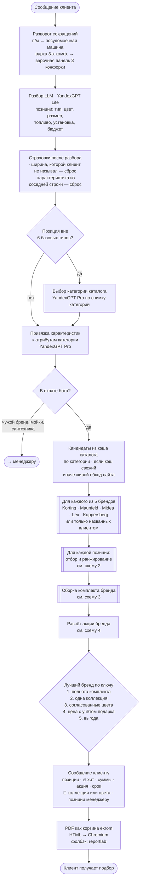
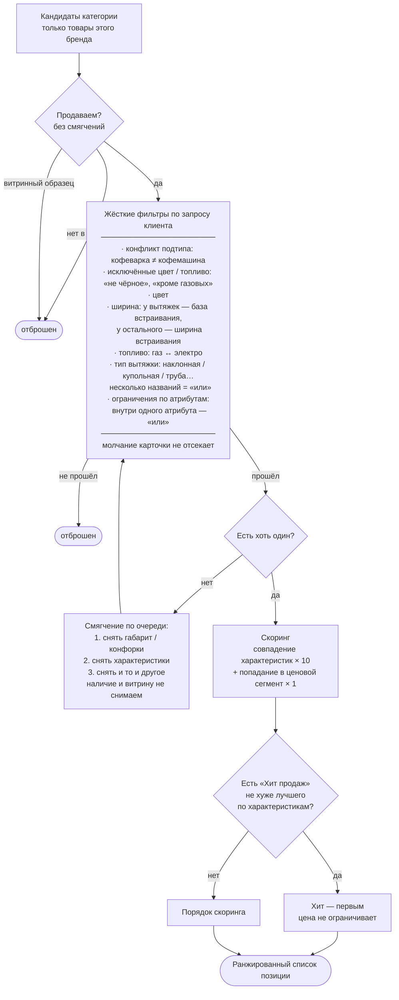
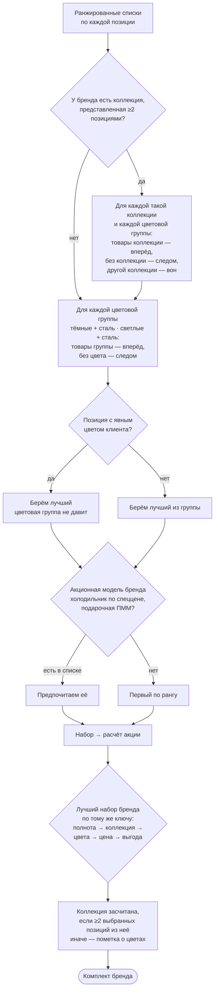
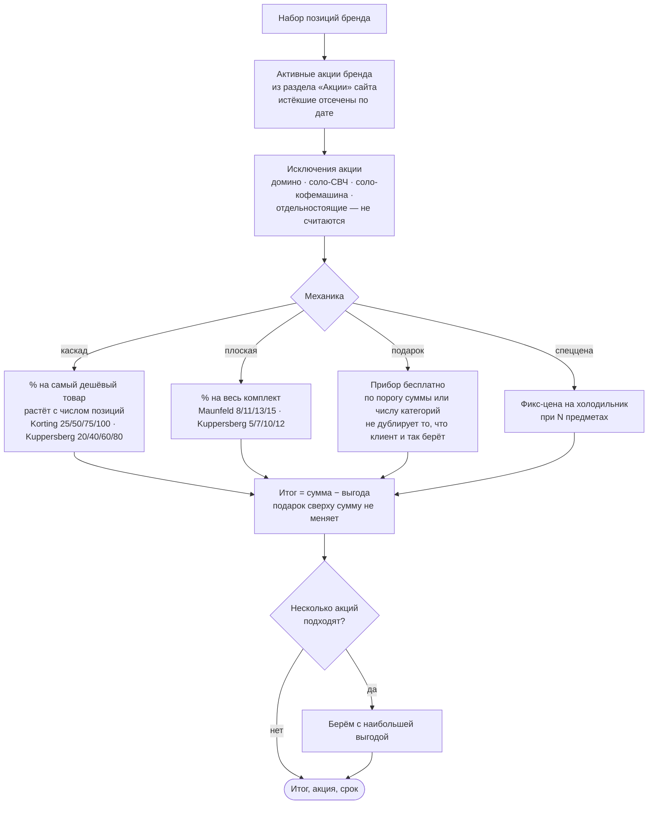

# Логика выбора товаров — от сообщения до PDF

Схема отражает код на 10.09.2026 (после доработок: наличие, витринный образец,
хит продаж, база встраивания, коллекции). Каждый блок — реальная функция;
ссылки на файлы внизу.

## Общая схема

## Схема 2 — отбор и ранжирование внутри одной позиции

## Схема 3 — сборка комплекта одного бренда

## Схема 4 — расчёт акции

## Где это в коде

| Блок | Файл |
|---|---|
| Разворот сокращений | `parsing/abbreviations.py` |
| Разбор LLM, страховки | `parsing/parser.py` (`drop_phantom_width`, `drop_leaked_attributes`) |
| Категории, привязка атрибутов | `parsing/category_resolver.py`, `parsing/attr_mapper.py` |
| Охват (5 брендов, менеджеру) | `matching/kit_builder.py` (`split_out_of_scope`, `client_brands`) |
| Кандидаты, кэш | `pipeline.py` (`_candidates_for_spec`), `ekrom/catalog_cache.py` |
| Продаваемость, фильтры, скоринг, хит | `matching/selector.py` (`is_sellable`, `_passes_filters`, `ranked_candidates`, `_promote_bestsellers`) |
| Сборка комплекта, коллекции, цвета | `matching/kit_builder.py` (`build_brand_kit`, `choose_best_kit`, `BrandKit.rank_key`) |
| Акции | `matching/combo_pricing.py` (`best_combo`), `ekrom/promos.py`, `ekrom/promo_store.py` |
| Сообщение клиенту | `messenger/client_ux.py` (`format_kit`) |
| PDF | `pdf/cart_html.py` (основной), `pdf/cart_style.py` (фолбэк) |
